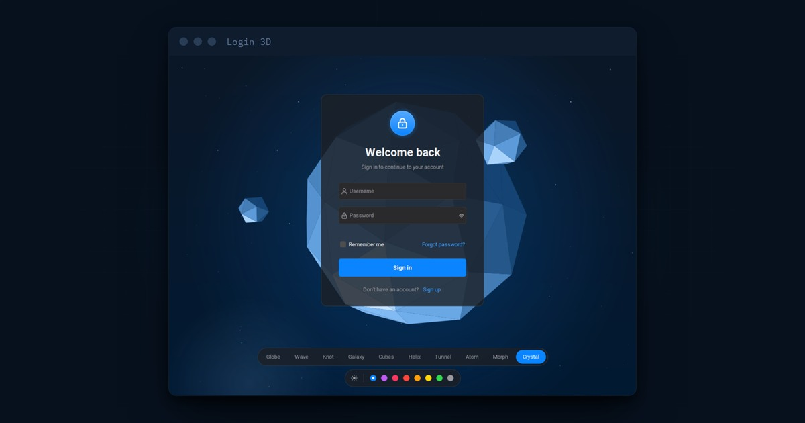

# Login 3D



A macOS style login card (`LoginForm`) on an animated 3D background (`Background3D`) that reacts to the mouse. The scenes are drawn with Java2D only: the 3D math, the projection, the depth sort and the lighting are plain Java, with no OpenGL and no native library.

- **10 scenes**: Globe, Wave, Knot, Galaxy, Cubes, Helix, Tunnel, Atom, Morph and Crystal. Switching scenes fades from one to the next.
- **Mouse effects**: the scene tilts toward the mouse, a drag spins it, a click sends a ripple, and each scene reacts in its own way.
- **macOS themes**: FlatLaf's Mac Light or Mac Dark theme with one of the 8 macOS accent colors. The background, the card and the whole UI follow the theme, and a change blends smoothly.
- **Login card**: lock badge, fields with icons, inline error messages, a macOS style shake on a wrong password, a loading spinner, a welcome state and remember me.
- **Paused when signed in**: after sign in, a home form takes the place of the background and the animation stops until sign out.
- **Theme bars**: `StyleSwitcher` gives two floating bars to pick the scene, the appearance and the accent.
- **Custom scenes**: a scene is a small class, and new ones appear in the bar by themselves.

> **Just for fun.** The background redraws the whole window 60 times a second on the CPU, so it uses a lot of CPU while it is shown, more on a large window. This is expected for a demo like this one. For a real application, pick a lighter scene, lower the frame rate (`FPS` in `Background3D`) or use a still background.

## Requirements

- Java 25.
- [FlatLaf](https://github.com/JFormDesigner/FlatLaf/) with `flatlaf-extras` (for the animated theme change) + [MigLayout](https://github.com/mikaelgrev/miglayout/).

## Usage

### 1. Add the background

`Background3D` is a `JPanel`. Give it a palette and a scene index, then lay your content on top of it:

```java
Palette palette = Palette.of(Palette.Accent.BLUE, true);   // accent, dark
Background3D background = new Background3D(palette, 0);    // 0 = Globe

background.setLayout(new MigLayout("fill", "[center]", "[center]"));
background.add(content);
frame.setContentPane(background);
```

It animates on its own thread while it is shown, and stops when it is removed from the window. The mouse effects follow the mouse over the components on top of it too.

Switch the scene or the colors at any time:

```java
background.setScene(6);                                   // fades to Tunnel
background.setPalette(Palette.of(Palette.Accent.GREEN, false));

List<String> names = background.getSceneNames();          // the order of setScene
```

To let the background run under the title bar like a macOS window, turn on FlatLaf's full window content, and let the top of the background drag the window:

```java
frame.getRootPane().putClientProperty(FlatClientProperties.FULL_WINDOW_CONTENT, true);
background.putClientProperty(FlatClientProperties.COMPONENT_TITLE_BAR_CAPTION, true);
```

### 2. The scenes and their mouse effects

| # | Scene | What it shows | Mouse effect |
|---|---|---|---|
| 0 | Globe | A globe of connected points | Points near the mouse light up and link to it |
| 1 | Wave | A wire grid rolling like the sea | The grid rises into a hill under the mouse |
| 2 | Knot | A wire tube tied in a torus knot | Points near the mouse link to it |
| 3 | Galaxy | A spiral galaxy with a bright core | Stars move away from the mouse |
| 4 | Cubes | Wire cubes floating up at different depths | The cube under the mouse glows and spins faster |
| 5 | Helix | A DNA double helix, twisting | Base pairs near the mouse light up |
| 6 | Tunnel | A flight through a twisting tunnel | The tunnel bends toward the mouse; a drag flies faster |
| 7 | Atom | A nucleus with electrons on three orbits | Electrons speed up as the mouse nears the nucleus |
| 8 | Morph | Particles flowing from a sphere to a cube, a torus and a spring | Particles move away from the mouse |
| 9 | Crystal | A shaded low poly gem with three small gems around it | The light comes from the mouse |

In every scene, a drag on the background spins the scene and a click sends a ripple.

### 3. The login card

```java
Settings settings = Settings.load();
LoginForm form = new LoginForm(settings, palette) {
    @Override
    protected boolean authenticate(String username, char[] password) {
        return userService.login(username, password);
    }
};
form.setOnSignedIn(username -> showHome(username));   // after a short welcome on the button
background.add(form);
frame.getRootPane().setDefaultButton(form.getSignInButton());
form.focusFirstField();                            // after the frame is shown
```

Once signed in, swap the content pane for your own form. Taking the background out of the window stops its animation thread, so it uses no CPU while the user is signed in. Putting it back starts the animation again:

```java
void showHome(String username) {
    frame.setContentPane(new HomePanel(username, settings.remember, palette, this::signOut));
    frame.getRootPane().setDefaultButton(null);
    frame.revalidate();
    frame.repaint();
}

void signOut() {
    frame.setContentPane(background);              // the animation starts again
    frame.getRootPane().setDefaultButton(form.getSignInButton());
    frame.revalidate();
    frame.repaint();
    form.focusFirstField();
}
```

`LoginForm` clears itself before `setOnSignedIn` runs: no password, no message, and the username only when remember me is checked. `HomePanel` is a simple example home form with the account, the session and a sign out button; replace it with the form of your application.

> **Replace `authenticate`.** By default it accepts any password of 4 characters or more, to show both outcomes.

The password comes as a `char[]` and is wiped after the check. The check runs on the event thread after a short pause that shows the loading state, so move a slow check (a network call) into a `SwingWorker`.

What the card does:

| Action | Result |
|---|---|
| Sign in with an empty field | The field turns red, a message says what is missing, and the card shakes |
| Enter in the username | Goes on to the password, or signs in when the password is filled |
| Enter in the password | Signs in |
| Sign in | A spinner and "Signing in..." while the fields are locked |
| Wrong password | "Incorrect username or password.", a shake, and the password is selected to type again |
| Right password | A check and "Welcome, *name*" on the button, then the `setOnSignedIn` action |

### 4. macOS themes

A `Palette` is one of the macOS accent colors in the light or the dark appearance. It holds every color the background and the card use. Set the FlatLaf Mac theme in the same accent, so the rest of the UI (selection, caret, focus) matches:

```java
static void setLookAndFeel(Palette palette) {
    FlatLaf.setGlobalExtraDefaults(Map.of("@accentColor", Palette.hex(palette.accent)));
    if (palette.dark) {
        FlatMacDarkLaf.setup();
    } else {
        FlatMacLightLaf.setup();
    }
}
```

When the theme changes, update the Look and Feel, then the background and the card:

```java
FlatAnimatedLafChange.showSnapshot();               // optional fade, for a light/dark change
setLookAndFeel(palette);
FlatLaf.updateUI();
FlatAnimatedLafChange.hideSnapshotWithAnimation();
background.setPalette(palette);
form.setPalette(palette);
```

| Accent | Light | Dark |
|---|---|---|
| `BLUE` | `#007AFF` | `#0A84FF` |
| `PURPLE` | `#AF52DE` | `#BF5AF2` |
| `PINK` | `#FF2D55` | `#FF375F` |
| `RED` | `#FF3B30` | `#FF453A` |
| `ORANGE` | `#FF9500` | `#FF9F0A` |
| `YELLOW` | `#FFCC00` | `#FFD60A` |
| `GREEN` | `#28CD41` | `#32D74B` |
| `GRAPHITE` | `#8E8E93` | `#98989D` |

Add a value to `Palette.Accent` for a new color.

### 5. The theme bars

`StyleSwitcher` shows a bar of scene buttons and a bar with the light / dark button and the accent dots. It reports the choice, and leaves applying it to you:

```java
StyleSwitcher switcher = new StyleSwitcher(background.getSceneNames(), sceneIndex, palette,
        index -> background.setScene(index),
        newPalette -> applyTheme(newPalette));   // the code of step 4
background.add(switcher);
```

### 6. Remember the choices

`Settings` keeps the scene, the accent, the appearance and the username (when remember me is checked) in `.login3d.properties` in the home folder. The password is never saved.

```java
Settings settings = Settings.load();
Palette palette = Palette.of(settings.accent, settings.dark);
// ... after a change
settings.scene = index;
settings.save();
```

### 7. Add your own scene

Extend `Scene` and add it to the list in `Background3D`. Its button appears in the bar by itself.

```java
public class RingScene extends Scene {

    private final double[] out = new double[3];

    public RingScene() {
        super("Ring");
    }

    @Override
    public void paint(Graphics2D g2, View view) {
        double scale = Math.min(view.width, view.height) * 0.4;
        double cx = view.width / 2.0, cy = view.height / 2.0;
        view.setAngles(view.spinX + view.tiltX, view.spinY + view.tiltY);
        for (int i = 0; i < 60; i++) {
            double a = Math.PI * 2 * i / 60;
            view.project(Math.cos(a), 0, Math.sin(a), cx, cy, scale, 3, out);
            double depth = (1 - out[2]) / 2;              // 0 far, 1 near
            g2.setColor(view.node(depth));
            g2.fill(new Ellipse2D.Double(out[0] - 3, out[1] - 3, 6, 6));
        }
    }
}
```

Override `tick(View)` to move things forward on each frame. What a scene gets from `View`:

| Member | Meaning |
|---|---|
| `width`, `height` | The size of the background |
| `mouse` | The mouse on the background, `null` when it is outside |
| `mouseX`, `mouseY` | The mouse from -0.5 to 0.5 across the background, eased |
| `spinX`, `spinY` | The turn of the slow spin of its own and of the drag |
| `tiltX`, `tiltY` | The tilt toward the mouse |
| `frame` | The number of the frame |
| `setAngles(x, y)` + `project(...)` | Turns a point and gives its place on screen and its depth |
| `rotate(...)` | Turns a point and gives it back in 3D, to light it or test which way a face looks |
| `edge(depth)`, `node(depth)` | The theme color of a line and of a point, from far (0) to near (1) |
| `near`, `far`, `accent`, `light`, `glow`, `dark` | The theme colors, and whether the theme is dark |
| `mouseDistance(x, y)` | The distance on screen from the mouse |

`Scene` also gives `paintGlow(...)` for a soft round light and `linkMouse(...)` for a line from the mouse to a point in reach.

A frame has about 16 ms. Thousands of anti-aliased lines or dots fit in it, but outlining filled shapes on top of filling them roughly doubles the cost (see `CrystalScene`).

## Key classes

| Class | Role |
|---|---|
| `background.Background3D` | The animated background: stars, mouse tracking, drag, ripples, scene and theme fades, the 60 fps loop. |
| `background.Scene` | Base class of a scene, with glow and mouse link helpers. |
| `background.View` | What a scene gets for a frame: size, mouse, turn, projection and theme colors. |
| `background.Palette` | The macOS accent colors, and every color of a theme in light or dark. |
| `background.GlobeScene` … `CrystalScene` | The ten scenes. |
| `LoginForm` | The sign in card, with `authenticate` to override and `setOnSignedIn` to open the application. |
| `HomePanel` | An example form shown once signed in, with a sign out button. |
| `StyleSwitcher` | The bars to pick the scene, the appearance and the accent. |
| `Settings` | Loads and saves the choices and the remembered username. |
| `GlyphIcon` | The small drawn icons: user, lock, check, sun, moon and spinner. |
