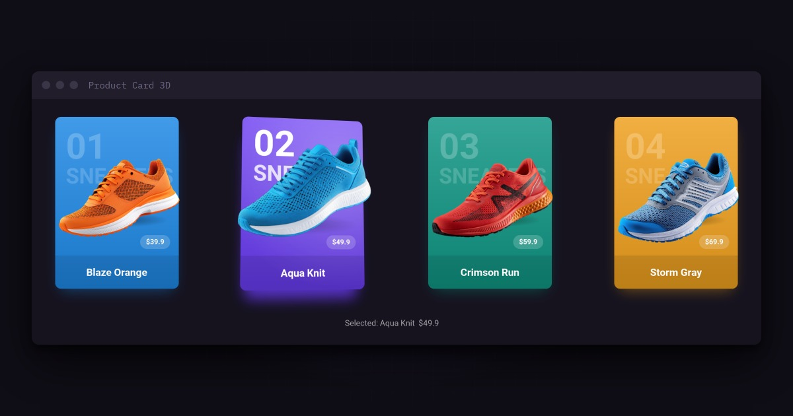

# Product Card 3D



A product card (`ProductCard`) that tilts in 3D toward the mouse while its product image pops out of the card. Everything is drawn with Java2D: the perspective projection is plain Java, with no OpenGL and no native library.

- **3D tilt**: the card turns toward the mouse with a real perspective, not a skew, and eases back flat when the mouse leaves.
- **Pop out with parallax**: the card, the big title and the product sit at different depths, so on hover the product lifts out past the card edge, grows a little and turns toe up, while its shadow on the card spreads.
- **Hover light**: the faded number and category brighten, a soft light follows the mouse and a glow in the card color sits under the card.
- **Click**: pressing pushes the card in, and an `ActionListener` gets the click.
- **HiDPI**: every layer is drawn at the screen scale, so text and images stay sharp at 125%, 150% or 200%.
- **Reusable**: content, colors, font, tilt, depth and size are bean properties that repaint the card when changed.

## Requirements

- Java 25.
- Nothing else: `ProductCard` only uses Swing. The demo adds [FlatLaf](https://github.com/JFormDesigner/FlatLaf/) and [MigLayout](https://github.com/mikaelgrev/miglayout/) for the window.

## Usage

### 1. Create a card

Give it the number, category, product name, price, card color and product image:

```java
Image shoe = ImageIO.read(getClass().getResource("shoe-orange.png"));

ProductCard card = new ProductCard("01", "SNEAKERS", "Blaze Orange", "$39.9", new Color(0x1e88e5), shoe);
panel.add(card);
```

Or start empty and fill it with the setters:

```java
ProductCard card = new ProductCard();
card.setNumber("01");
card.setCategory("SNEAKERS");
card.setProductName("Blaze Orange");
card.setPrice("$39.9");
card.setCardColor(new Color(0x1e88e5));
card.setProductImage(shoe);
```

The card asks for some room around itself (its preferred size is larger than the card), because the product and the tilt reach outside the card. Use the layout's normal gaps between cards.

The card is **responsive**: when the layout gives it less than its preferred size, the room around the card shrinks first (and the pop out with it, so nothing is cut off), then the card itself scales down, to half its size at most (its minimum size). With MigLayout, a row like `"push[][][]push"` does this by itself when the window gets narrow.

### 2. Prepare the product image

- Use a **transparent PNG** and crop it to the product. The card fits the image into its product area by itself, keeping its aspect ratio, so the size of the file doesn't matter, but empty space around the product makes it look small.
- About **1000 px wide** is plenty. The card scales the image once per screen scale and caches it, so a large image only costs memory.
- Tell the card which way the **toe** points, so the hover turns it up:

```java
card.setFacing(ProductCard.Facing.LEFT);   // default: toe on the left
card.setFacing(ProductCard.Facing.RIGHT);  // toe on the right
```

`setProductImage(null)` shows a card without a product.

### 3. Handle clicks

```java
card.addActionListener(e -> openProduct(card.getProductName()));
```

The action command of the event is the product name. A disabled card (`setEnabled(false)`) doesn't tilt or fire clicks.

### 4. Style the card

```java
card.setCardColor(new Color(0x6a3cf2));          // gradient and glow are made from it
card.setForeground(new Color(0x222222));          // text color, white by default (use dark text on a light card)
card.setFont(new Font("Poppins", Font.PLAIN, 13)); // font family of all texts; the sizes are fixed by the design
card.setPrice("");                                // empty hides the price pill
```

Without `setFont`, the card uses the font of its parent, like any Swing component.

### 5. Tune the effect

```java
card.setMaxTilt(14);     // largest tilt angle in degrees, 0 keeps the card flat
card.setDepth(1);        // how far the title and the product pop out, 0 = no pop out, up to 3
card.setCardScale(0.8);  // card size relative to the 230 x 320 design size
```

`setCardScale` changes the preferred and minimum size too, and scales everything together (text, image, glow and depth), so the card keeps its look at any size.

## Properties

| Property | Default | Description |
|---|---|---|
| `number` | `""` | Big faded text at the top, e.g. `"01"`. |
| `category` | `""` | Large faded word under the number, e.g. `"SNEAKERS"`. |
| `productName` | `""` | Name at the bottom; also the action command of clicks. |
| `price` | `""` | Text of the price pill; empty hides the pill. |
| `cardColor` | `#1e88e5` | Base color of the card gradient and of the glow under it. |
| `productImage` | `null` | Product picture, best a transparent PNG cropped to the product. |
| `facing` | `LEFT` | Which way the toe points in the image. |
| `maxTilt` | `14` | Largest tilt angle in degrees (0 to 45). |
| `depth` | `1` | Pop out strength on hover (0 to 3). |
| `cardScale` | `1` | Card size relative to 230 x 320 (0.25 to 4). |
| `foreground` | white | Color of all texts. |
| `font` | parent's font | Font family of all texts. |

Every setter fires a `PropertyChangeEvent` with the property name above and repaints the card.

## Key classes

| Class | Role |
|---|---|
| `ProductCard` | The card component: properties, mouse tracking, animation and the layered drawing. |
| `Perspective` | Package private helper that draws an image onto any four-corner shape with a perspective mapping. |

## How it works

On each frame the card draws four flat layers into images: the glow, the card face, the title and the product. Each layer is then rotated in 3D around the card center at its own depth and projected through a camera, and `Perspective` maps the image onto the projected shape pixel by pixel with bilinear filtering. Layers that are closer to the camera move more when the card tilts, which gives the parallax.

The animation only runs while something moves: the timer stops as soon as the card is back at rest, and only the card under the mouse repaints. At rest, the layers are copied directly without the perspective mapping, so the card is pixel sharp.

## Demo images

The shoe images of the demo come from [Vecteezy](https://www.vecteezy.com) and were cropped and scaled down; see `IMAGE-CREDITS.md` next to them. Use your own product images in your application.
